<a href="https://nerozhen.de"></a>

 

Hey, I'm **Nerozhen** :3 - born in April 2006 and a furry since 2019.

I build **websites** (portfolios and community sites), **Discord bots** and **Minecraft mods**, and I keep growing a **homelab** that is definitely not too big.
When I'm not breaking my own servers I'm playing Minecraft, Sons of the Forest, Project Zomboid and a lot more.

More about me on **[nerozhen.de](https://nerozhen.de)**.

  <a href="https://www.eurofurence.org">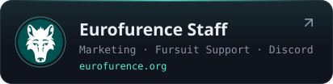</a>
  <a href="https://pawhost.de">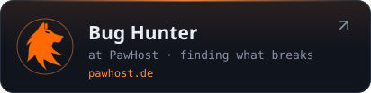</a>

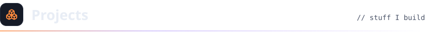

  <a href="https://pangobot.net">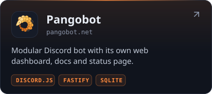</a>
  <a href="https://www.curseforge.com/members/nerozhen/projects">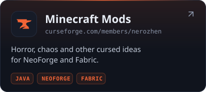</a>
  <a href="https://nerozhen.de">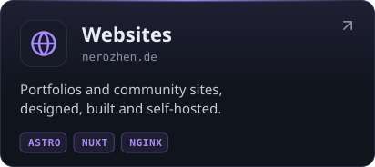</a>
  <a href="https://github.com/furnero/linux-scripts">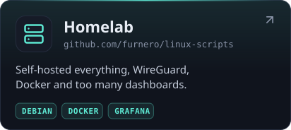</a>

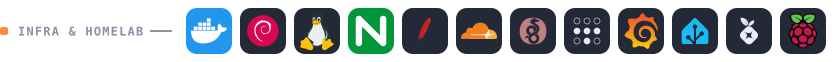

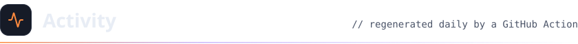

  
  
  
  
  

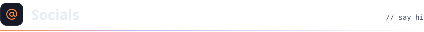

  
  
  
  
  
  
  
  

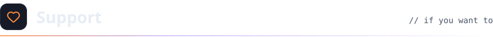

  

